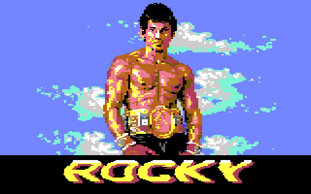
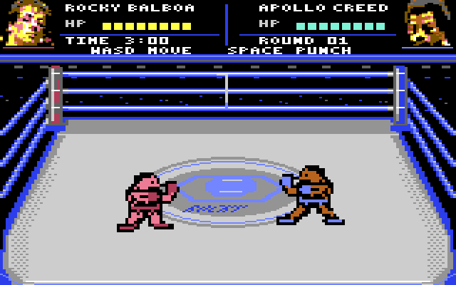

# Rocky

A small boxing game for the Commodore 64, written in 6502 assembly with KickAssembler. It is a fan project, made after the course.




## Build and run

```bash
java -jar KickAss.jar rocky.asm
x64sc rocky.prg
```

`rocky.asm` imports `fight.asm` and loads the graphics from the `.bin` files, so keep them in the same folder.

## Controls

- SPACE on the title screen: start
- W, A, S, D: move
- SPACE: punch
